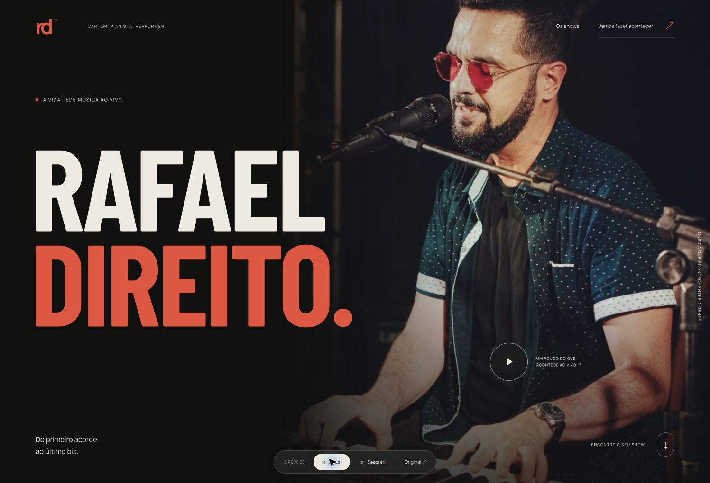
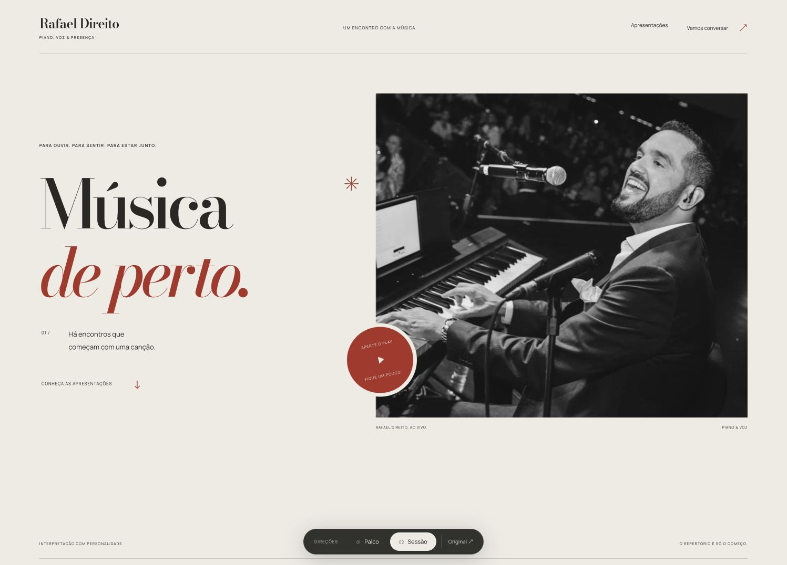

# Rafael Direito — estudos de direção de arte

Duas propostas navegáveis em HTML, CSS e JavaScript, sem instalação ou build.

- `dist/index.html`: **Palco** — fotografia imersiva, tipografia condensada, preto e vermelho.
- `dist/sessao.html`: **Sessão** — composição editorial, papel, fotografia e tipografia serifada.
- `dist/original.html`: cópia do HTML recebido para comparação.

A barra fixa inferior pertence à apresentação das propostas. Ela deve ser removida da versão final escolhida.

As propostas incluem vídeos reais, seleção de formatos (Palco), navegação por teclado, suporte a movimento reduzido e contato com o WhatsApp da produção já informado no arquivo original. Não há coleta de dados ou formulário com envio automático.

## Visualizar localmente

Abra `dist/index.html` no navegador, ou execute nesta pasta:

```sh
python3 -m http.server 8766 --directory dist --bind 127.0.0.1
```

Depois acesse `http://127.0.0.1:8766`.

As mídias são locais. As fontes estão em `dist/assets/fonts/`; as propostas funcionam sem rede. Links para Instagram e WhatsApp precisam de conexão.

## Publicar na Vercel

O arquivo `vercel.json` configura este repositório como site estático, com `dist/` como pasta de publicação. Não é necessário instalar dependências ou executar build.

## Prévia das propostas

| Palco | Sessão |
| --- | --- |
|  |  |

## Próxima etapa

Escolher a direção visual antes de desenvolver a versão comercial definitiva: biografia aprovada, credenciais, formulário, metadados sociais e revisão do conteúdo com o artista.
